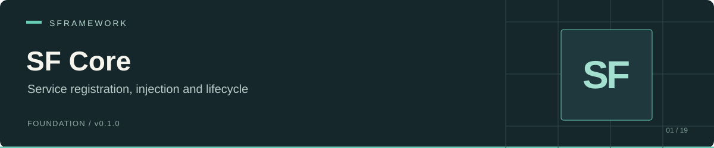

# SF Core

 

SF Core provides a shared service container, reflection-based dependency injection, and Unity scene lifecycle components for the SFramework modules. Use it to register application services in a scene context, inject them into classes or views, and initialize services in a defined order.

The container holds one global set of bindings. It supports constructor arguments, annotated fields and properties, and annotated methods. It also includes a logger facade, editor settings, and asset-search helpers.

[Installation](#installation) · [Lifecycle](#lifecycle) · [Example](#example) · [API](#api) · [Behavior and limits](#behavior-and-limits) · [Repository map](#repository-map)

## Installation

In Unity Package Manager, choose **Add package from git URL**:

```text
https://github.com/huran438/sf-core.git#main
```

You can also add this entry to the `dependencies` object in `Packages/manifest.json`:

```json
"sp.sframework.core": "https://github.com/huran438/sf-core.git#main"
```

The branch URL tracks `main`. Replace the branch with a reviewed commit hash when you need a fixed source snapshot.

### Required assemblies

The [package manifest](package.json) does not declare a `dependencies` field. Install the required packages in the host project; Package Manager cannot infer them from the assembly definition.

| Requirement | Evidence | Setup |
| --- | --- | --- |
| `UniTask` | [Runtime assembly references](Runtime/SFramework.Core.Runtime.asmdef); `ISFService` returns `UniTask` | Supply the Cysharp UniTask assembly. No dependency version appears in this repository. |
| `SFramework.Debug.Runtime` | [Runtime assembly references](Runtime/SFramework.Core.Runtime.asmdef) | Install [SF Debug](https://github.com/huran438/sf-debug). |
| `JetBrains.Annotations` | [Core logger source](Runtime/SFDebug.cs) uses `StringFormatMethod` | Ensure the Unity environment supplies that namespace. The manifest does not declare a separate annotations package. |

If your own code uses an assembly definition, reference `SFramework.Core.Runtime` and `UniTask` as needed. Reference `SFramework.Core.Editor` only from editor code.

The manifest does not state a minimum Unity version. `SFContextRoot` uses `MonoBehaviour.destroyCancellationToken`, and the source uses modern C# syntax such as target-typed `new`. Check these APIs and syntax against your target editor before adopting the package. The package version does not certify compatibility with a particular Unity release.

## Lifecycle

[`SFContainer`](Runtime/SFContainer.cs) scans loaded assemblies after Unity loads them, caches injection metadata for classes implementing `ISFInjectable`, and clears previous bindings, interface mappings, and service registrations.

[`SFContextRoot`](Runtime/SFContextRoot.cs) then runs this sequence:

1. In `Awake`, create the initialization completion source and call `PreInit()`.
2. Call `Bind()` so the application can register services and other instances.
3. Call `SFContainer.Setup()` to inject registered instances.
4. In `Start`, await registered `ISFService.Init(CancellationToken)` calls in registration order.
5. Await the context's `Init(CancellationToken)`, set `IsInitialized`, and complete the initialization task.

You can await `context.WaitForInitialization()` or `await context`. Wait after the context's `Awake` has run.

[`SFView`](Runtime/SFView.cs) calls `PreInit()` and injects itself in `Awake`. Its annotated `Init()` hook runs during that injection, which can precede asynchronous service initialization. A view that needs initialized services should await its context before using those services.

The [editor execution-order helper](Editor/SFSetExecutionOrder.cs) sets concrete context scripts to order `-1` when their current order is nonnegative. It keeps existing negative orders. Check your scene's execution order if other scripts register or consume services in `Awake`.

## Example

Create `ExampleContext.cs` with the following code. Add `ExampleContext` to a scene GameObject. This example registers a service, injects a plain class, waits for service initialization through the context lifecycle, and disposes the service that the context owns.

```csharp
using System.Threading;
using Cysharp.Threading.Tasks;
using SFramework.Core.Runtime;
using UnityEngine;
using CoreDebug = SFramework.Core.Runtime.SFDebug;

public interface ICounterService : ISFService
{
    int Value { get; }
    void Increment();
}

public sealed class CounterService : ICounterService
{
    public int Value { get; private set; }

    public UniTask Init(CancellationToken cancellationToken)
    {
        cancellationToken.ThrowIfCancellationRequested();
        Value = 10;
        return UniTask.CompletedTask;
    }

    public void Increment() => Value++;
    public void Dispose() { }
}

public sealed class CounterPresenter : ISFInjectable
{
    [SFInject]
    public ICounterService Counter { get; private set; }
}

public sealed class ExampleContext : SFContextRoot
{
    private ICounterService _counter;

    protected override void PreInit()
    {
        CoreDebug.RegisterLogger(UnityEngine.Debug.unityLogger);
        CoreDebug.SetDebug(true);
    }

    protected override void Bind()
    {
        _counter = SFContainer.Register<ICounterService, CounterService>();
    }

    protected override UniTask Init(CancellationToken cancellationToken)
    {
        cancellationToken.ThrowIfCancellationRequested();
        var presenter = new CounterPresenter();
        presenter.Inject();
        presenter.Counter.Increment();
        UnityEngine.Debug.Log(presenter.Counter.Value); // 11
        return UniTask.CompletedTask;
    }

    private void OnDestroy()
    {
        _counter?.Dispose();
    }
}
```

Use `SFContainer.Register<TService>(instance)` when your application constructs an instance. For automatic constructor arguments, register each argument's exact type before calling `Register<TService, TImplementation>()`. Prefer one constructor per implementation: the container selects the first declared constructor without choosing between overloads.

### Inject a scene view

Create `CounterView.cs`, add it to a GameObject, and assign the scene's `ExampleContext` to **Context**:

```csharp
using Cysharp.Threading.Tasks;
using SFramework.Core.Runtime;
using UnityEngine;

public sealed class CounterView : SFView
{
    [SerializeField] private ExampleContext _context;
    [SFInject] private ICounterService _counter;

    private async UniTaskVoid Start()
    {
        await _context.WaitForInitialization();
        UnityEngine.Debug.Log($"Counter: {_counter.Value}");
    }
}
```

The view gets its dependency in `Awake`; the wait protects its use from the later service initialization in `Start`. These examples assume one context and an active scene with the configured references.

## API

All runtime types below use the `SFramework.Core.Runtime` namespace.

| API | Purpose |
| --- | --- |
| `ISFInjectable` | Marker interface required for reflection-based member injection. |
| `ISFService` | Adds `UniTask Init(CancellationToken)` and `IDisposable` to the marker interface. |
| `[SFInject]` | Marks instance fields, properties, or methods for injection. Methods receive resolved arguments. |
| `SFContainer.Register<TService, TImplementation>()` | Constructs and stores an implementation under the service type. |
| `Register<TService, TImplementation>(object)`, `Register<TService>(object)`, `Register(Type, object)` | Store an existing instance. |
| `Resolve<T>()`, `Resolve(Type)` | Resolve an exact registered type, then the first assignable registered type; return `null` if none matches. |
| `ResolveMany<T>()` | Return bindings recorded under interfaces inherited or implemented by registered key types. |
| `Bindings`, `GetDependencies<T>()` | Inspect registered values or values assignable to `T`. |
| `Setup()`, `Inject(object)` | Inject registered objects or one target. `target.Inject()` delegates to `Inject(object)`. |
| `Inject(GameObject, bool includeInactive = false)` | Inject child components implementing `ISFInjectable`, with optional inactive components. |
| `InitServices(CancellationToken)` | Initialize services sequentially in registration order. |
| `SFContextRoot` | Defines `PreInit`, `Bind`, and asynchronous `Init`; exposes completion state and await support. |
| `SFView` | Injects a view during `Awake`; provides `PreInit` and an annotated `Init` hook. |
| `SFTypeUtility.GetTypeByName(string)` | Look up a cached short type name from selected loaded assemblies. |
| `SFTypeUtility.CreateInstance(Type, params object[])` | Construct through public or nonpublic instance constructors; the generic overload casts the result. |
| `SFrameworkSettings<T>.TryGetInstance(out T)` | Read editor JSON settings; create a default file and return `false` on the first call if the file is absent. |
| `[SFHideScriptField]` | Hide `m_Script` through the package's default MonoBehaviour editor. |
| `string.IsNone()` | Test for `null`, an empty string, or whitespace. |

### Core logging

Core defines its own [`SFDebug`](Runtime/SFDebug.cs), separate from `SFramework.Debug.Runtime.SFDebug`. Use namespace aliases if your code imports both.

Call `RegisterLogger(ILogger)` before expecting Core logs. The logger set starts empty; the facade sends each call to registered loggers. `SetDebug(bool)` controls the `IsDebug` flag that container diagnostics check. The facade's `Log` and `Exception` methods themselves do not test that flag.

Severity overloads place `LogType` first, for example `CoreDebug.Log(LogType.Warning, "Missing binding: {0}", typeName)`. Core exposes no logger-removal or reset method.

### Editor utilities

[`SFEditorExtensions`](Editor/SFEditorExtensions.cs), in `SFramework.Core.Editor`, provides `FindAssets<T>`, `FindPrefabs`, `FindAssetsPath`, and one-level `SerializedProperty` enumeration. `FindPrefabs` requires each requested component type, on the root by default or through `GetComponentInChildren` with `FindOptions.ConsiderChildren`. `ISFEditorTool` supplies a `Title` contract.

## Behavior and limits

- The container has global static state and no scopes, unregister method, or automatic service disposal. Define application ownership and dispose services yourself. Destroying the context cancels the token passed to initialization through Unity's `destroyCancellationToken`; it does not remove bindings.
- `Setup()` and `Inject()` execute annotated methods each time you call them. Repeating injection can repeat side effects.
- An unregistered member or method argument resolves to `null`. Automatic constructor injection uses exact dictionary lookups; on the first missing argument, it still invokes the constructor with unfilled entries. Register constructor dependencies first and validate references in consuming code.
- Registering an existing key overwrites its dictionary value but appends interface mappings and service entries again. Avoid duplicate registration: it can duplicate `ResolveMany` results and initialization calls.
- `ResolveMany<T>()` uses recorded interfaces, rather than filtering all binding values. `GetDependencies<T>()` filters the values and serves a different purpose.
- Injection requires a cached concrete type implementing `ISFInjectable`. Targets outside that cache receive no injection. Assembly scanning uses reflection without a type-load exception handler; validate reflection and stripping behavior in your target player.
- The context does not complete its wait task with an error when initialization throws. A consumer can remain waiting after a failure. The repository supplies no recovery or retry policy.
- `SFTypeUtility` only scans assembly names starting with `Assembly-CSharp`, `UnityEngine`, or `SF`, caches short names once, and keeps the first duplicate. It can miss types in differently named custom assemblies.
- Editor settings live at `Assets/SFramework/Settings/<TName>.json`. Player builds return `false` and `default`; they do not read that editor file.

If logs disappear, check the Core logger registration and the namespace you use. If an injected reference is `null`, check its registration key, the target's marker interface, and whether injection ran after registration. If compilation reports missing assemblies, install the dependencies listed above.

## Repository map

| Source | Responsibility |
| --- | --- |
| [Runtime/SFContainer.cs](Runtime/SFContainer.cs) | Registration, resolution, reflection injection, service initialization. |
| [Runtime/SFContextRoot.cs](Runtime/SFContextRoot.cs), [Runtime/SFView.cs](Runtime/SFView.cs) | Unity lifecycle integration. |
| [Runtime/ISFInjectable.cs](Runtime/ISFInjectable.cs), [Runtime/ISFService.cs](Runtime/ISFService.cs), [Runtime/SFInjectAttribute.cs](Runtime/SFInjectAttribute.cs) | Runtime contracts and annotation. |
| [Runtime/SFInjectableTypeInfo.cs](Runtime/SFInjectableTypeInfo.cs) | Internal cached member metadata. |
| [Runtime/SFDebug.cs](Runtime/SFDebug.cs), [Runtime/SFTypeUtility.cs](Runtime/SFTypeUtility.cs), [Runtime/SFrameworkSettings.cs](Runtime/SFrameworkSettings.cs) | Logging, reflection helpers, editor JSON settings. |
| [Editor/](Editor/) | Asset helpers, script-field editor, context execution order. |
| [package.json](package.json) | Package identity and version. |

## Related modules

Public companion repositories include [SF Bootstrap](https://github.com/huran438/sf-bootstrap), [SF Configs](https://github.com/huran438/sf-configs), [SF Pools](https://github.com/huran438/sf-pools), [SF UI](https://github.com/huran438/sf-ui), [SF Conditions](https://github.com/huran438/sf-conditions), and [SF ECS](https://github.com/huran438/sf-ecs). Each module has its own assembly and dependency requirements.

## Validation and license

This README describes source snapshot `35729e3b15d7c7002dfd487deb7bb8ccc5c0af84`. The examples were inspected statically against the repository's signatures; they were not executed or compiled in Unity. Verify editor compilation, scene execution, and your intended player target in the host project.

MIT License. See [LICENSE.md](LICENSE.md).
